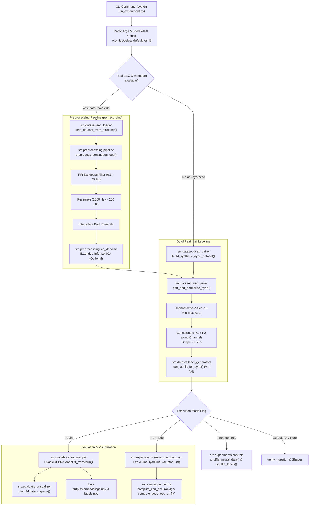
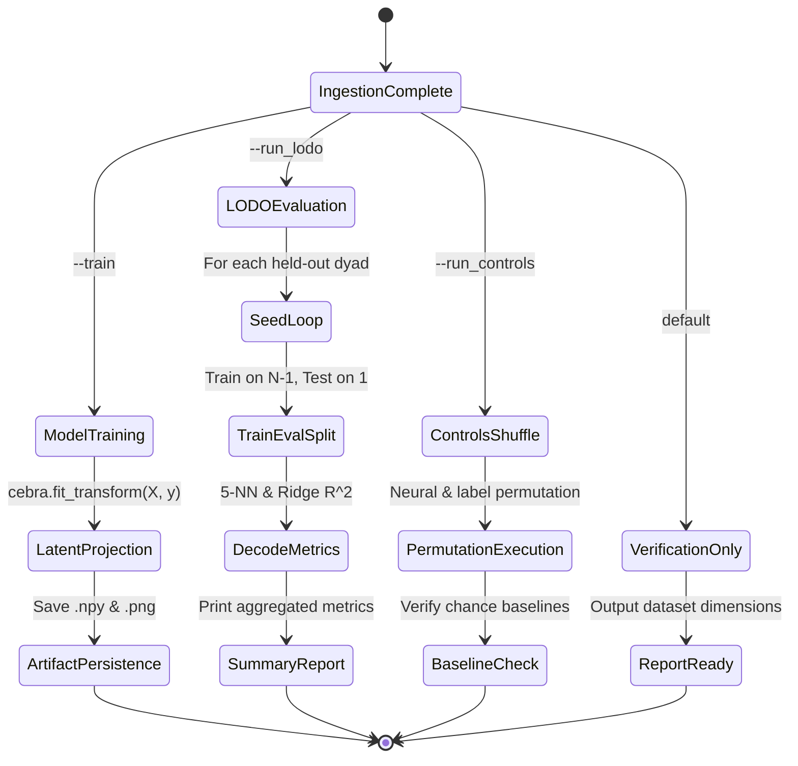

# Code Execution and Pipeline Flow: Neurodyad

This document outlines how code execution moves through the **Neurodyad** codebase. It covers system entry points, configuration propagation, data loading, preprocessing, model execution modes, evaluation routines, and output artifacts.

---

## 1. High-Level Architecture & Execution Flow



---

## 2. System Entry Points

The codebase provides two primary execution entry points:

### 1. Primary Entry Point: [`run_experiment.py`](run_experiment.py)
Orchestrates the end-to-end pipeline: loads configuration, prepares datasets, routes execution to training, controls, or leave-one-dyad-out (LODO) cross-validation, and persists outputs.

```bash
# Ingestion check / data verification
python run_experiment.py --config configs/cebra_default.yaml --label_version v3

# Train 3D CEBRA model
python run_experiment.py --train

# Run Leave-One-Dyad-Out (LODO) validation on real or synthetic data
python run_experiment.py --run_lodo
python run_experiment.py --run_lodo --synthetic

# Run permutation sanity checks
python run_experiment.py --run_controls
```

### 2. Diagnostic Entry Point: [`scripts/inspect_edf.py`](scripts\inspect_edf.py)
Diagnostic utility to inspect file headers, sampling frequency, channel count, and record duration for raw EEG files in `data/raw/` without running the full neural pipeline.

```bash
python scripts/inspect_edf.py
```

---

## 3. Detailed Step-by-Step Execution Lifecycle

### Phase 1: Configuration & CLI Parsing
- **Trigger**: Execution begins in `run_experiment.py:main()`.
- **Action**:
  - `parse_args()` reads flags (`--config`, `--data_dir`, `--metadata_csv`, `--label_version`, `--train`, `--run_lodo`, `--run_controls`, `--synthetic`).
  - Reads `configs/cebra_default.yaml` into a configuration dictionary.
  - Overrides hyperparameters if CLI flags (e.g. `--max_iterations`, `--num_seeds`) are provided.

### Phase 2: Metadata & Dataset Resolution
- **Files**: `run_experiment.py`, [`src/dataset/eeg_loader.py`](src/dataset/eeg_loader.py), [`data/metadata/dyads_metadata.csv`](data/metadata/dyads_metadata.csv).
- **Execution**:
  1. `run_experiment.py` checks whether `--synthetic` was passed or whether real raw recordings exist in `data/raw/` mapped by `data/metadata/dyads_metadata.csv`.
  2. If real data is present and `--synthetic` is not set:
     - Calls `eeg_loader.load_dataset_from_directory()`.
     - Parses each metadata row into a `DyadMetadata` dataclass object (dyad ID, filenames, gender pairing, AQ scores, role swap sample index).
  3. If files are missing or `--synthetic` is set:
     - Calls `build_synthetic_dyad_dataset(n_dyads=8)` in `run_experiment.py`, generating mock 8-dyad data with realistic channel dimensions and metadata.

### Phase 3: Raw EEG Ingestion & Preprocessing
- **File**: [`src/preprocessing/pipeline.py`](src/preprocessing/pipeline.py), [`src/preprocessing/ica_denoise.py`](src/preprocessing/ica_denoise.py).
- **Order of Execution for each participant file**:
  1. `load_eeg_file(file_path)` determines file format (`.edf`, `.bdf`, `.fif`, `.set`, `.npy`) and loads data via `mne.io`.
  2. Channel selection: `raw.pick('eeg')` isolates brain channels from peripheral bipolar channels.
  3. `preprocess_continuous_eeg()`:
     - Bandpass filter: `raw.filter(l_freq=0.1, h_freq=45.0, fir_design='firwin')`.
     - Resampling: Downsamples from native frequency (e.g., $1000\,\text{Hz}$) to $250.0\,\text{Hz}$.
     - Bad channels: Appends marked bad channels and executes `raw.interpolate_bads()`.
  4. (Optional) `run_extended_infomax_ica()`: Fits 15 independent components and subtracts ocular/cardiac artifacts.
  5. Extracts raw array as $(T \times C)$ matrix.

### Phase 4: Dyadic Channel Pairing & Normalization
- **File**: [`src/dataset/dyad_pairer.py`](src/dataset/dyad_pairer.py).
- **Execution**:
  1. `load_dyad_from_files()` calls `pair_and_normalize_dyad(eeg_p1, eeg_p2)`.
  2. Length truncation: Synchronizes recording lengths to $T_{\min} = \min(T_1, T_2)$.
  3. Two-stage normalization per participant via `normalize_channels()`:
     - Z-scoring: $z = (x - \mu) / (\sigma + \epsilon)$
     - Min-Max scaling: $\tilde{x} = (z - \min(z)) / (\max(z) - \min(z) + \epsilon)$
  4. Channel concatenation:
     $$X_{\text{joint}} = [ \tilde{x}^{(1)}, \tilde{x}^{(2)} ] \in \mathbb{R}^{T \times 2C}$$
  5. Registers the paired array and metadata into `DyadDataset.dyads[dyad_id]`.

### Phase 5: Behavioral Label Formulation
- **File**: [`src/dataset/label_generators.py`](src/dataset/label_generators.py).
- **Execution**:
  - `dataset.get_neural_and_labels(label_version=args.label_version)` queries `get_labels_for_dyad()`.
  - Depending on the selected label version:
    - **v1**: Generates block labels combining dyad identity and role phase ($2 \cdot \text{dyad\_id} + \text{swap}$).
    - **v2**: Generates dyad identity labels ($\text{dyad\_id}$).
    - **v3**: Generates conversational role turn labels ($0$ for Speaker, $1$ for Listener).
    - **v4**: Generates absolute AQ disparity labels ($|\text{AQ}_1 - \text{AQ}_2|$).
    - **v5**: Generates signed directional AQ disparity labels with shift offset ($(\text{AQ}_{\text{speaker}} - \text{AQ}_{\text{listener}}) + \text{offset}$).
    - **v6**: Generates chronological time partition bins ($30$ equal intervals).
  - Concatenates dyad feature matrices into global $X$ and label vector $y$.

---

## 4. Operational Branching Modes

Once $X$ and $y$ are constructed, execution routes into one of four distinct workflows:



### Mode A: Full Model Training (`--train`)
1. Instantiates `DyadicCEBRAModel` with parameters from `configs/cebra_default.yaml`.
2. Calls `model.fit_transform(X, y)`:
   - Initializes CEBRA neural encoder (`offset10-model`).
   - Optimizes contrastive InfoNCE loss across 5,000 iterations using GPU (`cuda:0`).
   - Produces 3D normalized spherical embeddings $Z \in \mathbb{R}^{T \times 3}$.
3. Saves outputs to `outputs/embeddings.npy` and `outputs/labels.npy`.
4. Invokes `src.evaluation.visualizer.plot_3d_latent_space()` to render and save `outputs/latent_space_<label>.png`.

### Mode B: Leave-One-Dyad-Out Cross-Validation (`--run_lodo`)
1. Checks that at least 2 dyads exist (prompts user to use `--synthetic` if only 1 dyad is present).
2. Initializes `LeaveOneDyadOutEvaluator`.
3. Outer Loop: Iterates over each dyad $k \in \{1, \dots, N\}$:
   - Partitions dataset into $X_{\text{train}}, y_{\text{train}}$ from $N-1$ dyads and $X_{\text{test}}, y_{\text{test}}$ from held-out dyad $k$.
4. Inner Loop: Iterates over random seeds ($1 \dots 5$):
   - Fits CEBRA model on $X_{\text{train}}, y_{\text{train}}$.
   - Projects both train and test data into the learned 3D latent space.
   - Computes decoding metrics in [`src/evaluation/metrics.py`](src/evaluation/metrics.py):
     - `compute_knn_accuracy()`: 5-NN classifier with cosine distance metric.
     - `compute_goodness_of_fit()`: Ridge regression $R^2$ score predicting behavior from latent coordinates.
5. Aggregates mean and standard deviation across seeds for each held-out dyad and outputs summary table.

### Mode C: Permutation Sanity Controls (`--run_controls`)
1. Invokes `shuffle_neural_data(X)` in [`src/experiments/controls.py`](src/experiments/controls.py) to temporally shuffle input samples.
2. Invokes `shuffle_behavioral_labels(y)` to break brain-behavior associations.
3. Confirms shapes and displays baseline configuration for control testing.

### Mode D: Ingestion Verification (Default)
1. Default behavior when no action flags are provided.
2. Prints loaded dataset matrix shapes, confirmed sampling frequencies, and reports pipeline readiness.

---

## 5. Data Shape Transformations

The table below traces tensor and matrix transformations across each file in the execution flow:

| Stage / Module | Input Shape | Output Shape | Description |
| :--- | :--- | :--- | :--- |
| **Raw Ingestion** (`eeg_loader.py`) | Raw `.edf` on disk | $T_i \times C$ | Individual participant continuous EEG ($C = 64$ or $65$). |
| **Preprocessing** (`pipeline.py`) | $T_i \times C$ | $T_{\text{resampled}} \times C$ | Resampled to $250\,\text{Hz}$, filtered $0.1\text{--}45\,\text{Hz}$. |
| **Pairing & Normalization** (`dyad_pairer.py`) | $2 \times (T_{\text{resampled}} \times C)$ | $T_{\min} \times 2C$ | Truncated to minimum length, normalized, concatenated. |
| **Labeling** (`label_generators.py`) | Metadata + sample count | $T_{\min}$ | Integer label vector corresponding to V1–V6. |
| **Global Stacking** (`dyad_pairer.py`) | List of $K$ dyad matrices | $X \in \mathbb{R}^{(\sum T) \times 2C}$, $y \in \mathbb{Z}^{(\sum T)}$ | Unified training matrix across all dyads. |
| **CEBRA Encoding** (`cebra_wrapper.py`) | $X \in \mathbb{R}^{T_{\text{batch}} \times 2C}$ | $Z \in \mathbb{R}^{T_{\text{batch}} \times 3}$ | 1D Conv receptive field projects to 3D unit sphere $S^2$. |
| **Evaluation Decoding** (`metrics.py`) | $Z \in \mathbb{R}^{T \times 3}$, $y \in \mathbb{Z}^T$ | Scalar ($R^2$, Accuracy) | 5-NN score and Ridge regression performance. |

---

## 6. Inter-Module Dependency Map

```
run_experiment.py
 ├── configs/cebra_default.yaml
 ├── src/dataset/
 │    ├── eeg_loader.py ──> src/preprocessing/pipeline.py ──> src/preprocessing/ica_denoise.py
 │    ├── dyad_pairer.py
 │    └── label_generators.py
 ├── src/models/
 │    └── cebra_wrapper.py ──> cebra library (PyTorch / CUDA)
 ├── src/experiments/
 │    ├── leave_one_dyad_out.py ──> src/evaluation/metrics.py
 │    ├── controls.py
 │    └── ablations.py
 └── src/evaluation/
      ├── metrics.py ──> scikit-learn (KNeighborsClassifier, Ridge, r2_score)
      └── visualizer.py ──> matplotlib (3D projection)
```

